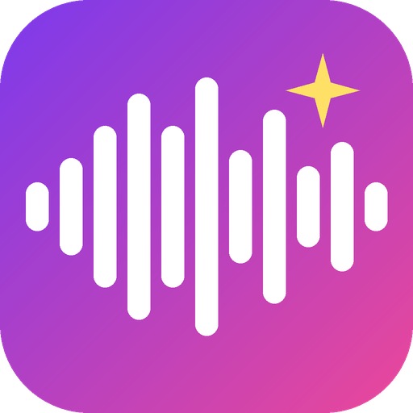

# Make Sound Great Again

<p align="center"></p>

Paste a link (YouTube, TikTok, Instagram, …) or drop a file, and get a cleaner, better-sounding copy of the song.
Works on **Windows, macOS and Linux**. Arabic and English interface, light and dark mode.

الصق رابط أغنية (يوتيوب، تيكتوك، انستا …) أو اسحب ملف، ويطلع لك نسخة أنظف وأوضح.
يشتغل على **ويندوز وماك ولينكس**، بواجهة عربية وإنجليزية ومود فاتح وداكن.

## What it does

- Downloads the best available audio (or reads your local file).
- **Detects the source quality** (bitrate, lossless or not, missing high frequencies) and picks a preset automatically.
- Noise reduction, EQ, gentle harmonic "air", and **two-pass loudness normalization** (-14 LUFS) with a limiter.
- Saves **FLAC** (lossless) or **MP3 320**, keeping the cover art and tags.
- **A/B player** at equal loudness: compare the original and the enhanced version.
- Playlists, parallel jobs, progress bars, clear error messages.
- **Cancel** or **retry** any song; your **history survives restarts**; a link you already processed with the same settings isn't redone.
- **Try another preset** on a finished song without downloading again, and **fine-tune bass / treble** (±6 dB).
- **Spectrogram** (before / after) to *see* what changed, not just hear it.
- Formats: **FLAC, MP3 320, M4A (AAC 256), Opus 192, WAV 24-bit**.
- **Notification** when everything is done; paste a link from the clipboard; `Ctrl+Enter` to start.
- **Choose files or a whole folder** from the system dialog: songs are processed in place (your originals are never copied or moved), videos are turned into audio.
- **Watch a folder**: new songs dropped into it are enhanced automatically (existing files are left alone).
- **Edit tags** (title / artist / album) and **change the cover** of a finished song, without re-encoding.
- **Target loudness**: -14 LUFS (Spotify / YouTube), -16 (Apple Music), -11, -9, or leave the level alone.
- **AI noise removal** (light, local): RNNoise models through ffmpeg's `arnndn`, one for music and one for speech. Only used when you pick them.

> It can't bring back detail a low-quality source never had (a 64 kbps clip gets cleaner and clearer, not studio quality).

## Light on your computer

- Pure Python standard library for the app itself: no heavy GUI toolkit, no Electron (the window reuses the webview already in your OS).
- The heavy work runs at **low CPU priority** by default (Settings → Light mode).
- Polls rarely while idle, closing the window quits the app, and in browser mode it **quits by itself** when the page is closed.

## Install

### Windows: just download the app (no Python, no ffmpeg install)

Go to the **[Releases](../../releases/latest)** page and download either:

- **`Make-Sound-Great-Again-Setup.exe`**: a normal installer (per-user, no admin rights, Start menu + optional desktop shortcut, uninstaller), or
- `Make-Sound-Great-Again-windows.zip`: portable; extract it and double-click **`Make Sound Great Again.exe`**.

ffmpeg is already inside. **Updates install themselves** from inside the app (Settings → Check for updates → Update): it downloads the new version, verifies its SHA-256, replaces its own files and restarts. (Windows needs the Edge WebView2 runtime, already present on Windows 10/11.)
Windows SmartScreen may warn about an unsigned app: *More info → Run anyway*.

### From source (all systems)

You need **Python 3.8+** and **ffmpeg** (with ffprobe). `yt-dlp` and the window library are installed for you by the start scripts.

| OS | ffmpeg | Start |
|---|---|---|
| Windows | `winget install ffmpeg` | double-click `start.bat` |
| macOS | `brew install ffmpeg` | double-click `start.command` (first time: `chmod +x start.command`) |
| Linux | `sudo apt install ffmpeg` | `./start.sh` (optional: `scripts/install_linux_shortcut.sh` for a desktop icon) |

Or by hand:

```bash
pip install -r requirements.txt
python run.py
```

The app is a **real desktop app with its own window**, never a browser tab. On Windows/macOS the window comes from `pywebview` (installed by `pip install -r requirements.txt`; Windows also needs the Edge WebView2 runtime, already present on Windows 10/11), on Linux from the system's GTK + WebKit2 (`sudo apt install gir1.2-webkit2-4.0` if missing). On Windows/macOS it never falls back to the browser: if the window can't start you get an error message saying why. (`python run.py --browser` forces browser mode if you ever want it.)

> macOS tip: if Python (from python.org) reports certificate errors, run "Install Certificates.command" once, or `pip install certifi`.

### Command line

```bash
python -m msga.cli "https://www.youtube.com/watch?v=XXXX"
python -m msga.cli song.mp3 -p bass -f mp3
python -m msga.cli --playlist "https://www.youtube.com/playlist?list=XXXX" -j 2
```

## Settings

Open the gear icon: language (العربية / English), appearance (System / Light / Dark), light mode, output folder,
**version number and one-click updates**, and an "Update engine" button for yt-dlp (YouTube changes often; this fixes most download failures).

Your settings live outside the program folder (`%APPDATA%\MakeSoundGreatAgain`, `~/Library/Application Support/MakeSoundGreatAgain`, `~/.config/make-sound-great-again`), so updating never touches them. Default output: `Music/Make Sound Great Again`.

## Updates

The app **checks for updates when it starts** (a red dot appears on the gear icon; turn it off in Settings), and if a download fails it **updates yt-dlp by itself and retries once**.
Manual: *Settings → Check for updates → Update → Restart.* The app reads `msga/version.py` on this repository's `main` branch and, if the number is higher, downloads the new files (or runs `git pull` if you cloned it).
To release a new version: bump `VERSION` in `msga/version.py` and push to `main`.
If you fork it, set your own repo with `python scripts/set_repo.py YOUR_USERNAME` (a git clone detects it automatically).

## Standalone builds (no Python needed)

Pushing a version tag builds the apps on GitHub and attaches them to a release (the Windows build bundles an LGPL ffmpeg, checksum-verified in CI; the macOS build needs `brew install ffmpeg`):

```bash
git tag v1.1.0 && git push origin v1.1.0
```

Packaged builds update by downloading the new release (the app opens the download page for you). The release workflow smoke-tests each build before publishing.

## Fonts

- The title uses **Audiowide** (SIL OFL 1.1, bundled, see `msga/web/fonts`).
- Arabic text uses the **Thmanyah (ثمانية) font if it's installed on your system**. It is *not* included here because its license doesn't allow redistribution; download it from Thmanyah's official site and install it, and the app picks it up automatically. Without it, a fallback font is used.

## Development

```bash
python -m unittest discover -s tests -v
```

CI runs the tests on Windows, macOS and Linux for every push.

## Legal

Download only what you have the right to use. You are responsible for how you use this tool and for respecting the terms of the sites and the copyright of the content.

MIT licensed (see `LICENSE`).
